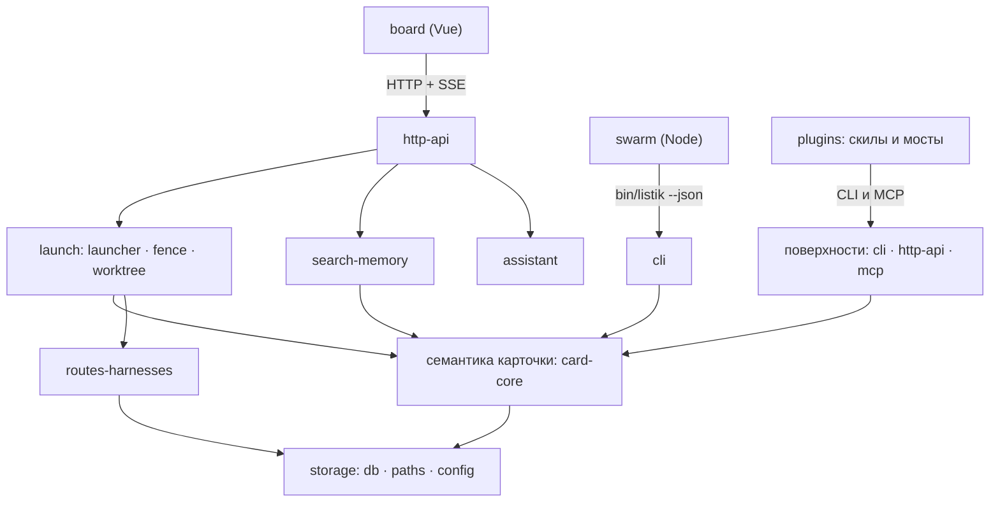

# Архитектура Listik

Один сервер, одна база SQLite, один API в трёх обличьях (CLI, HTTP, MCP). Код — чистый Python 3.11+
со стандартной библиотекой; доска — отдельная сборка Vue 3; рой — отдельный процесс на Node.

## Модули

Документ, принятый в граф узлом на месте: `listik-api` (`docs/API.md` — контракт данных и
эндпоинтов, источник истины по поведению). `docs/harness-protocol.md` раздаётся в чужие проекты
байт в байт и шапки не несёт — его узел `listik-protocol` описан в `specs/protocol.md`.

| Узел | Где | Отвечает за |
|---|---|---|
| `listik-backend` | `listik/` | пакет сервера: база, семантика задач, поиск, маршруты, запуск |
| `listik-cli` | `bin/listik` | CLI и клиент API в одной программе |
| `listik-board` | `web/` | доска: канбан, список, метрики, карточка, поиск |
| `listik-swarm` | `bin/listik-swarm`, `swarm/` | рой: волны задач, барьер слияния |
| `listik-plugins` | `plugins/`, `.claude-plugin/` | маркетплейс плагинов Claude Code |

Внутри `listik-backend` свои границы — у каждой свой подмодуль-спека: `listik-card-core`,
`listik-storage`, `listik-http-api`, `listik-mcp`, `listik-search-memory`,
`listik-routes-harnesses`, `listik-launch`, `listik-assistant`, `listik-install-ops`.

## Слои и рёбра

Стрелка — «знает о», обратных рёбер нет. Надзор за роем (`swarm_proc`, `swarm_watch`,
`swarm_llm`) живёт в пакете, рядом с запуском: сервер поднимает процесс роя, а git-слой
наблюдателя и единственная точка модельного вызова — обычные функции пакета (см. `listik-swarm`).

## Инварианты

- **Вся запись карточки идёт через семантику** (`listik-card-core`). HTTP-слой, локальный фолбэк CLI
  и MCP только разбирают запрос и зовут её — правил этапов, держателя и зависимостей вне ядра нет.
- **Листовые модули.** `errors` (формат ошибки) и `statuses` (наборы статусов) не импортируют ничего
  из пакета: их тянет любой слой без цикла импортов.
- **Ограждение не знает о поверхностях.** `fence` импортирует только `errors` и `store` — иначе
  получился бы цикл `server → fence → server`.
- **Запуск не знает о сервере.** `launcher` не импортирует `server`: события доски приходят
  колбэком `notify`.
- **Чистые git-слои.** `worktree` и `swarm_watch` не знают ни о базе, ни о сервере; решение, что
  писать в карточку, принимает вызывающий.
- **Рой — отдельный процесс, но его надзор живёт в пакете:** запуск, слежение за деревьями и
  единственная точка модельного вызова описаны в `listik-swarm` вместе с самим роем.
- **Рой говорит с Listik только через установленный CLI** (`bin/listik … --json`) и не держит
  состояния между тиками: падение переживается перезапуском, повторный тик видит настоящие карточки
  и не запускает дважды.
- **Таблица маршрутов главнее файла.** `routes.json` — только затравка пустой таблицы при установке;
  после ввоза файл не перечитывает и ни с чем не сверяет никто, кроме явного `routes --reimport`.
- **Живая база в WAL.** Прямой доступ CLI и работающий сервер сосуществуют; копировать базу файлом
  нельзя — только через `backup`/`restore`.
- **Две миграции схемы.** Мягкая в `db.SCHEMA`/`SCHEMA_VERSION` — рабочий путь, который держит базу
  пользователя живой без зависимостей; `alembic/` — читаемая история изменений и путь для тех, кто
  держит схему сам. Любое изменение схемы делается в обеих (решение подтверждено автором).
- **Ошибка — один формат** на всех трёх поверхностях: один и тот же `code` и `hint` агент видит и
  через HTTP, и когда сервер не поднят.

## Решения

- **Рой — отдельный процесс на Node, а не поток Python-сервера.** Выбрано по удобству разработки:
  автору так было ближе и быстрее (подтверждено). Следствия, которые код держит намеренно: тик не
  держит состояния, падение роя не роняет сервер и очередь, git и дочерние процессы не мешают
  HTTP-обслуживанию.
- **Идентичность заявленная, а не доказанная** — общий токен и `--owner`/`--actor`. Это осознанная
  граница продукта (см. не-цели в `listik-goal`), а не недоделка.
- **Доска только показывает.** Этап меняется из панели задачи или протоколом, перетаскивания
  карточек нет: движение по конвейеру — решение агента, а не жест мышью.
